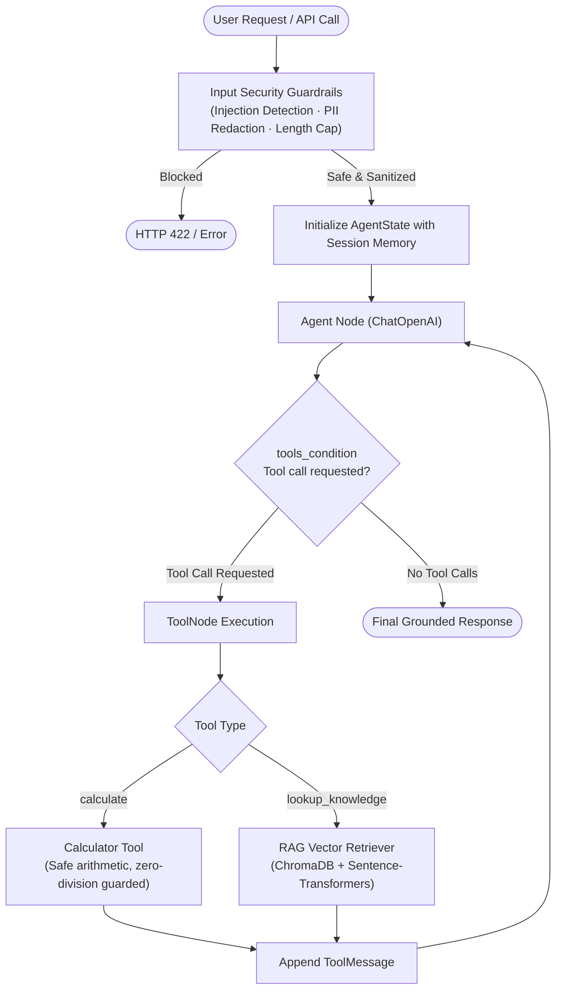
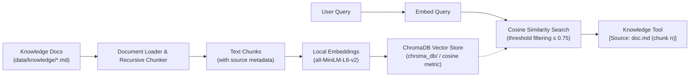

# AgentOps AI

> Enterprise-grade autonomous AI Business Intelligence & Research Agent powered by LangGraph, ChromaDB RAG, FastAPI, and Layered Security Guardrails.

[](https://www.python.org/)
[](https://github.com/langchain-ai/langgraph)
[](https://www.trychroma.com/)
[](https://fastapi.tiangolo.com/)
[]()

AgentOps AI is a production-oriented agentic system designed to transform high-level business queries into grounded, verifiable, and auditable intelligence reports. It integrates cyclical state machine orchestration, multi-turn conversation memory, input security guardrails, deterministic arithmetic tooling, local Retrieval-Augmented Generation (RAG), and a production REST API with an automated evaluation harness.

---

## Architecture Overview

AgentOps AI is constructed around an event-driven, cyclical state machine orchestrated by **LangGraph**, backed by **OpenAI models**, and augmented with **local vector retrieval**, **session memory**, and **security guardrails**.



---

## Core Capabilities & Completed Milestones

| Milestone | Subsystem | Implementation Details |
| :--- | :--- | :--- |
| **Milestone 1** | **Agent Foundation** | `LangGraph` StateGraph foundation, typed state schemas, environment isolation. |
| **Milestone 2** | **Tool Calling & Routing** | Cyclical `ToolNode` orchestration with deterministic arithmetic (+, -, *, /) and business knowledge lookup. |
| **Milestone 3** | **Production RAG** | Persistent `ChromaDB` vector store, local `sentence-transformers` (`all-MiniLM-L6-v2`), recursive chunking, and cosine threshold filtering. |
| **Milestone 4** | **Persistent Conversation Memory** | LangGraph `MemorySaver` thread checkpointing enabling multi-turn conversational context retention across turns and sessions. |
| **Milestone 5** | **Input Security Guardrails** | Regex-based prompt injection detection (8 patterns), PII redaction (email, phone, credit card numbers), and 4,096-character enforcement. |
| **Milestone 6** | **FastAPI REST API** | Production HTTP API (`/chat`, `/ingest`, `/health`) with CORS, Pydantic v2 schemas, auto-generated OpenAPI/Swagger docs, and lifespan pre-warming. |
| **Milestone 7** | **RAG Evaluation Harness** | Automated regression benchmark with a 12-question golden Q&A dataset evaluating retrieval hit-rate, keyword hit-rate, source accuracy, and latency. |

---

## Production RAG Subsystem

The Retrieval-Augmented Generation (RAG) subsystem ensures enterprise knowledge is indexed locally and retrieved with mathematical precision.



### How RAG Works in AgentOps AI
1. **Document Loading**: Ingests Markdown and text documents from `data/knowledge/` preserving file lineage.
2. **Recursive Text Chunking**: Splits documents along section and paragraph boundaries (`chunk_size=500`, `chunk_overlap=50`) while retaining source file names, chunk indices, and unique identifiers.
3. **Local Dense Embeddings**: Generates 384-dimensional dense vectors using `sentence-transformers` (`all-MiniLM-L6-v2`) locally on-device. No internal documentation is transmitted to third-party embedding APIs.
4. **ChromaDB Indexing**: Persists embeddings and chunk metadata to `chroma_db/` using cosine similarity (`hnsw:space: cosine`). Ingestion uses `upsert` with deterministic IDs (`doc_chunk_idx`) to guarantee idempotency.
5. **Distance Threshold Filtering**: Retrieves top-$k$ relevant chunks and discards matches with a cosine distance $> 0.75$, returning `"No relevant information found"` for out-of-domain queries rather than injecting misleading noise.
6. **Source Attribution**: Injects retrieved excerpts with explicit `[Source: filename.md (chunk N)]` headers into the tool message stream for transparent LLM reasoning.

---

## Project Structure

```text
AgentOps-AI/
├── app/
│   ├── agents/
│   │   ├── __init__.py        # Agent module exports
│   │   └── graph.py           # LangGraph StateGraph agent with tool-calling & memory
│   ├── api/
│   │   ├── __init__.py        # FastAPI app exports
│   │   └── server.py          # REST endpoints (/chat, /ingest, /health)
│   ├── evaluation/
│   │   ├── __init__.py        # Evaluation module exports
│   │   ├── benchmark.py       # CLI benchmark runner with Markdown reporting
│   │   └── evaluator.py       # RAGEvaluator metrics (hit-rate, source accuracy, latency)
│   ├── memory/
│   │   ├── __init__.py        # Memory module exports
│   │   └── checkpointer.py    # LangGraph MemorySaver & session thread manager
│   ├── rag/
│   │   ├── __init__.py        # RAG module exports
│   │   ├── document_loader.py # Document parser and recursive text chunker
│   │   ├── ingest.py          # Knowledge base ingestion CLI & pipeline
│   │   └── retriever.py       # ChromaDB vector retriever and context formatter
│   ├── security/
│   │   ├── __init__.py        # Security module exports
│   │   └── guardrails.py      # Input validation, injection detection & PII redaction
│   ├── tools/
│   │   ├── __init__.py        # Tool module exports
│   │   ├── calculator.py      # LangChain arithmetic tool (+, -, *, /)
│   │   └── knowledge.py       # LangChain RAG knowledge retrieval tool
│   └── main.py                # Command-line entry point with interactive memory mode
├── data/
│   ├── evaluation/
│   │   └── golden_qa.json     # 12-question benchmark ground truth set
│   └── knowledge/             # Markdown knowledge base documents
│       ├── architecture.md    # System architecture and technical stack
│       ├── pricing.md         # Subscription tiers and feature matrix
│       ├── project_overview.md# Vision, capabilities, and target audience
│       └── security.md        # Governance, privacy, and secret management
├── docs/
│   ├── api.md                 # Full REST API specification & curl examples
│   └── architecture.md        # Architectural deep dive & component diagrams
├── tests/
│   ├── __init__.py
│   ├── test_agent.py          # Agent graph construction & cyclical tool-calling tests
│   ├── test_api.py            # FastAPI endpoints (/chat, /ingest, /health) test suite
│   ├── test_evaluation.py     # Evaluation metrics and benchmark tests
│   ├── test_memory.py         # LangGraph checkpointing & multi-turn memory tests
│   ├── test_rag.py            # Document chunking, embedding & indexing tests
│   ├── test_security.py       # Injection detection & PII redaction unit tests
│   └── test_tools.py          # Calculator arithmetic & RAG retrieval tests
├── .env.example               # Safe environment variable configuration template
├── requirements.txt           # Direct project dependencies
└── README.md                  # Comprehensive project documentation
```

---

## Installation & Setup

### 1. Prerequisites
- Python 3.12+
- Virtual environment (`.venv`)

### 2. Activate Virtual Environment & Install Dependencies
```bash
# Activate your existing Python 3.12 virtual environment
source .venv/bin/activate

# Install required direct dependencies
pip install -r requirements.txt
```

### 3. Configure Environment Variables
Copy the template configuration file:
```bash
cp .env.example .env
```
Edit `.env` to configure your settings:
```env
# OpenAI or Groq API configuration (for live LLM execution)
OPENAI_API_KEY=your_openai_api_key_here
OPENAI_MODEL=gpt-4o-mini

# Local RAG & Vector Database Configuration
CHROMA_PERSIST_DIRECTORY=chroma_db
EMBEDDING_MODEL=all-MiniLM-L6-v2
```

---

## Running the REST API

Start the FastAPI production server using Uvicorn:
```bash
python -m app.api.server
# Or: uvicorn app.api.server:app --host 0.0.0.0 --port 8000 --reload
```

Interactive Swagger documentation is automatically accessible at **`http://localhost:8000/docs`**.

### REST API Endpoints

#### 1. Chat with Agent (`POST /chat`)
```bash
# Stateless query
curl -X POST http://localhost:8000/chat \
  -H "Content-Type: application/json" \
  -d '{"message": "What is the annual cost of the Professional plan with a 10% discount?"}'

# Stateful conversation with persistent memory
curl -X POST http://localhost:8000/chat \
  -H "Content-Type: application/json" \
  -d '{"message": "What plans do you offer?", "use_memory": true}'
```

#### 2. Re-index Knowledge Base (`POST /ingest`)
```bash
curl -X POST http://localhost:8000/ingest \
  -H "Content-Type: application/json" \
  -d '{}'
```

#### 3. Health & System Check (`GET /health`)
```bash
curl http://localhost:8000/health
```

---

## Running the CLI Agent

### Stateless Execution
```bash
python -m app.main "How much does the Starter plan cost per year, and what would 3 months cost?"
```

### Stateful Multi-Turn Interactive Mode
```bash
python -m app.main --memory
```

---

## Running the RAG Evaluation Benchmark

Execute the automated benchmark against the 12 golden test questions:
```bash
python -m app.evaluation.benchmark --verbose
```

**Benchmark Results:**
```text
============================================================
AgentOps AI — RAG Evaluation Benchmark
============================================================
# AgentOps AI — RAG Evaluation Report

## Summary
| Metric | Value |
| :--- | ---: |
| Total Questions | 12 |
| Retrieval Rate | 100% (12/12) |
| Keyword Hit Rate | 100% (12/12) |
| Source Accuracy | 100% (12/12) |
| Overall Pass Rate | 100% (12/12) |
| Avg Retrieval Latency | 38.4 ms |
```

---

## Automated Testing Suite

The comprehensive offline test suite validates agent compilation, tool execution, ChromaDB vector indexing, security guardrails, memory persistence, REST endpoints, and evaluation metrics **without requiring paid external API calls**:

```bash
python -m pytest tests/ -v
```

```text
================================= test session starts ==================================
collected 88 items

tests/test_agent.py .................                                           [ 8%]
tests/test_api.py .................                                             [27%]
tests/test_evaluation.py ...............                                        [44%]
tests/test_memory.py ........                                                   [53%]
tests/test_rag.py .........                                                     [63%]
tests/test_security.py ........................                                 [90%]
tests/test_tools.py ........                                                    [100%]

========================= 88 passed, 4 subtests passed in 8.9s =========================
```

---

## Security & Secrets Policy

1. **Zero Hardcoded Secrets**: Secrets and API keys are strictly forbidden in source code and vector stores.
2. **Layered Input Guardrails**: Every query is screened for prompt injection attacks and stripped of PII prior to model inference.
3. **Environment Isolation**: `.env` and `chroma_db/` are explicitly listed in `.gitignore` and are never committed to version control.
4. **Local Privacy First**: Embeddings are computed locally using open-source sentence-transformer models. Proprietary knowledge documents never leave your infrastructure for vectorization.
